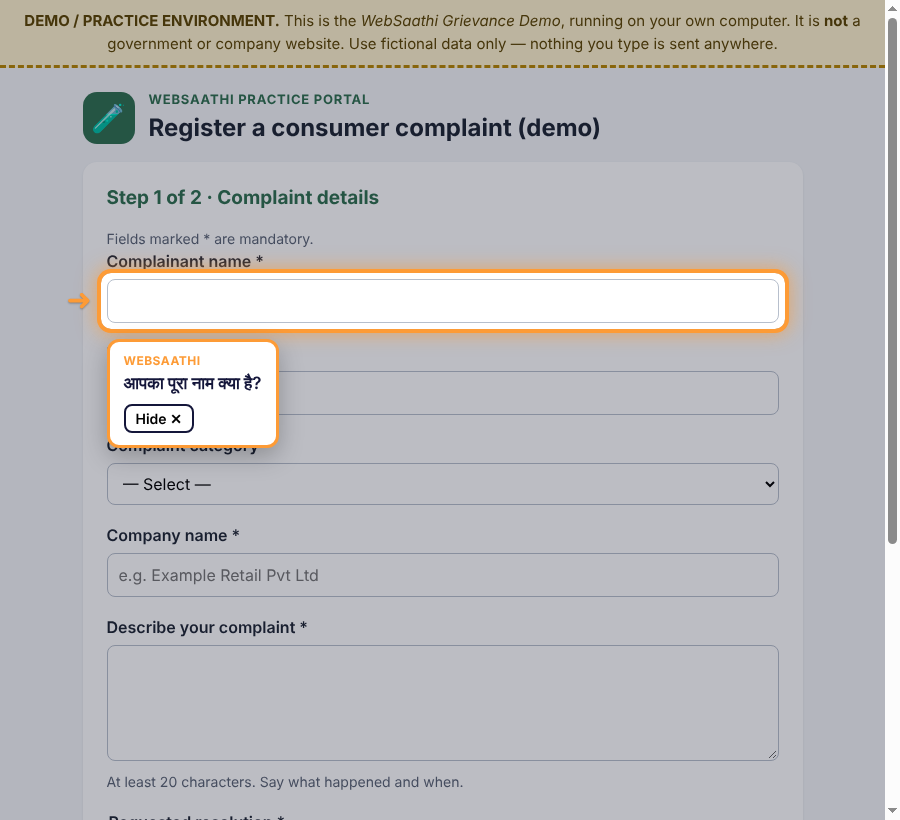
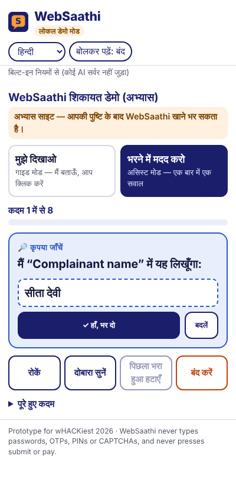

# WebSaathi

Ever opened an online form and had to ask someone what to click next? WebSaathi puts step-by-step help beside the page in Chrome. Follow along in **English, हिन्दी (Hindi), or ಕನ್ನಡ (Kannada)**.

[Try the demo](#try-the-demo) · [Follow the walkthrough](docs/demo-guide.md)

<p>
  
  
</p>

*Screenshots from the local demo. The interface is still evolving.*

## What you can do

- **Find an official website.** Type `mujhe consumer complaint karni hai` and WebSaathi shows the National Consumer Helpline address, `consumerhelpline.gov.in`, before you choose to open it.
- **See what to do next.** Choose **Show me** to highlight where to click or type. WebSaathi explains errors in plain language. **Read aloud** can speak the prompts if your device has a voice for the selected language.
- **Practise filling a form.** Choose **Help me fill** on the practice form. WebSaathi asks one question at a time and waits for your approval before filling each answer.

WebSaathi provides guidance on IRCTC, RailMadad, the National Consumer Helpline, and CPGRAMS. You handle passwords, one-time codes (OTPs), payments, and final submissions yourself.

## Try the demo

You’ll need **desktop Chrome 116 or later** and **Node.js 20 or later**.

```bash
git clone https://github.com/ayush-only/WebSaathi.git
cd WebSaathi
npm run demo
```

1. In Chrome, open `chrome://extensions` and turn on **Developer mode**.
2. Click **Load unpacked** and select the `apps/extension` folder inside `WebSaathi`.
3. Open the [practice form](http://localhost:5500/). Choose **WebSaathi** from Chrome’s **Extensions** menu, then select **Help me on this page** in the side panel.
4. Enter a sample name and confirm the fill. Try `sita at the rate example` for the email to see how WebSaathi explains the error and helps you fix it.

The practice form runs on your computer. Use fictional details. **Local Demo Mode** uses built-in guidance and works without an account or API keys.

## Learn more

[Demo walkthrough](docs/demo-guide.md) · [How it works](docs/architecture.md) · [Privacy and safety](docs/security.md) · [Roadmap](docs/roadmap.md)

Built for **wHACKiest 2026**, Track 02 — Beyond the Browser, by **AI slop aah** (Kshitij Gupta, Ayush Singh, Karanpreet Singh, and Ali Raza).
