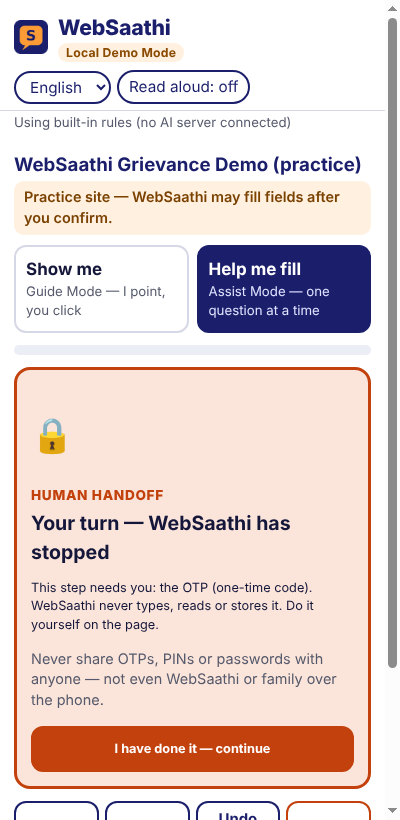
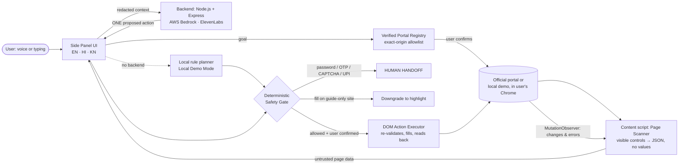

# WebSaathi — AI Web Companion for Non-Technical Users

**The web, explained in your language. Every step, under your control.**

WebSaathi is a desktop Chrome extension that sits beside the user like a patient family member. It sends them to the *official* website for their task, points at the next thing to do on the real page, asks for form answers one question at a time in English, Hindi or Kannada, explains website errors in plain language — and **stops** at passwords, OTPs, CAPTCHAs, payments and final submissions, so the user always does those themselves.

| | |
|---|---|
| **Hackathon** | wHACKiest 2026 · CodeRIT, Ramaiah Institute of Technology, Bengaluru |
| **Track** | Track 02 — Beyond the Browser |
| **Team** | AI slop aah — Kshitij Gupta · Ayush Singh · Karanpreet Singh · Ali Raza |
| **Status** | Working MVP (prototype). See [implementation status](#implementation-status) for exactly what is verified. |

<p>
  
  
  
</p>

*Screenshots captured from the running extension in this repository (Local Demo Mode).*

---

## The problem

Digital access does not guarantee digital independence. Booking on IRCTC, filing a complaint on RailMadad, the National Consumer Helpline or CPGRAMS means dense forms, unfamiliar terms, cryptic validation errors and look-alike scam sites. Parents, senior citizens, first-time internet users and regional-language speakers often have to hand the phone — and their passwords and OTPs — to someone else.

- **Screen readers** improve access and navigation, but don't turn a complex task into guided steps.
- **General AI browser agents** automate tasks, but aren't designed around step-by-step regional-language guidance for first-time users.
- **Family or cyber-café help** depends on availability and often means sharing passwords and OTPs.

## The solution

WebSaathi combines **verified official-portal routing**, **live guidance on the real page**, **regional-language help** and a **code-enforced human handoff** in one browser companion.

1. **Verified Portal Router (Scam Shield)** — type or say the goal (“mujhe consumer complaint karni hai”). WebSaathi picks the official site from a curated registry, shows the domain and purpose, and opens it only after the user confirms. The AI can never produce a URL.
2. **Guide Mode — “Show me”** — dims the page, draws a spotlight and arrow on the next control and explains it in one sentence. The user clicks; WebSaathi notices the page change and moves on.
3. **Assist Mode — “Help me fill”** — turns the form into one question at a time in the side panel, shows exactly what it will type and where, and fills the real field only after the user presses **Yes, fill it**. It reads the value back to confirm it worked, and can **Undo**.
4. **Multilingual voice** — UI, questions and explanations in English, हिन्दी and ಕನ್ನಡ; speech input through the browser where supported; spoken guidance through ElevenLabs (via the backend) or the browser voice. Typing always works.
5. **Human-only safety gates** — deterministic code (not the AI) detects passwords, OTPs, CAPTCHAs, card/UPI/PIN, Aadhaar and bank fields and turns any action on them into a **HUMAN HANDOFF**. WebSaathi has no “click” or “submit” action at all.
6. **Live Error Translator** — watches the page (MutationObserver, `invalid` events, ARIA error links, alert regions) and explains messages like “Invalid email address” or “File size exceeds 200KB” in simple language with a fix.
7. **Visible progress and control** — current step, mode, Live AI / Local Demo badge, completed steps, Pause, Repeat, Undo, Stop.

**Site policy.** On real portals (IRCTC, RailMadad, NCH, CPGRAMS) WebSaathi is **guide-only**: it points and explains, but never types or clicks. IRCTC's terms prohibit automation, and we never file test grievances with real services. Form filling is demonstrated on the clearly labelled local **WebSaathi Grievance Demo** practice form.

---

## Architecture



**Proposed action schema** (the only thing the AI or the rule planner may output):

```json
{ "actionType": "HIGHLIGHT_ELEMENT | ASK_QUESTION | FILL_FIELD | EXPLAIN_ERROR | HUMAN_HANDOFF | WAIT_FOR_USER | COMPLETE_GUIDANCE",
  "targetElementId": "ws-12", "instruction": "…", "reason": "…", "proposedValue": "only for FILL_FIELD",
  "requiresConfirmation": true, "riskLevel": "low | medium | high", "expectedOrigin": "http://localhost:5500" }
```

Unknown action types, extra keys (`script`, `url`, selectors), mismatched origins, unknown or hidden targets, secret-looking values and unconfirmed fills are rejected. The same gate runs in the side panel, on the backend, and **inside the content script immediately before touching the page** (it re-reads the element first). More in [docs/architecture.md](docs/architecture.md) and [docs/security.md](docs/security.md).

## Technology

| Layer | Choice |
|---|---|
| Extension | Chrome Manifest V3 · Side Panel API · content scripts · service worker · `chrome.storage.local` (language/voice preference only) |
| Extension code | Plain modern JavaScript, **no build step** — load the folder unpacked and it runs. (We chose this over React/TS/Vite for the 24-hour build so judges can install it without tooling; ESLint + automated tests cover the code.) |
| Shared core | `apps/extension/shared/` — registry, schema, safety gate, redaction, error translator, i18n, rule planner. Same files run in the side panel, content script, backend and tests. |
| Backend | Node.js 20+ · Express 5 · AWS SDK v3 (`@aws-sdk/client-bedrock-runtime`, Converse API) · ElevenLabs REST API |
| Voice | Web Speech API (`en-IN`, `hi-IN`, `kn-IN` where the browser supports them) · ElevenLabs · `speechSynthesis` fallback |
| Tests | `node:test` unit tests · Playwright (`playwright-core`, test-only) driving real Chrome with the real extension |

## Repository layout

```
apps/
  extension/        Chrome extension — load this folder unpacked
    manifest.json
    background/     service worker (opens the side panel)
    content/        page scanner, overlay, DOM executor, error watcher
    sidepanel/      UI, backend client, voice
    shared/         registry, schema, safety, redact, errors, i18n, planner
    pages/          microphone-permission helper page
  backend/          Node.js + Express API (Bedrock, ElevenLabs)
  demo-portal/      WebSaathi Grievance Demo (local practice form) + tiny static server
tests/
  unit/             safety, registry, planner, error translator, redaction, backend
  browser/          real Chrome: content script on the demo page + full extension E2E
docs/               architecture, demo guide, security, roadmap, screenshots
scripts/check.js    build check: syntax, manifest, permissions, secret scan
```

---

## Quick start (Local Demo Mode — no keys needed)

Requirements: **Google Chrome 116+** (desktop) and **Node.js 20+**.

```bash
git clone https://github.com/ayush-only/WebSaathi.git
cd WebSaathi
npm run demo          # starts the practice form at http://localhost:5500 (no install needed)
```

**Load the extension**

1. Open `chrome://extensions` and switch on **Developer mode** (top right).
2. Click **Load unpacked** and choose the `apps/extension` folder.
3. Pin WebSaathi (puzzle-piece icon → pin) and click its icon — the side panel opens.

**Try it**

1. Open http://localhost:5500 in a tab.
2. In the side panel press **Help me on this page** (or **Try the practice form**).
3. Follow [the demo walkthrough](#demo-walkthrough).

The badge in the panel says **Local Demo Mode**: steps come from built-in rules, not AI.

## Live AI mode (AWS Bedrock) and ElevenLabs voice — optional

```bash
cd apps/backend && npm install && cd ../..
cp .env.example .env        # fill in the values — .env is git-ignored
npm run backend             # http://127.0.0.1:8787
```

- **AWS Bedrock:** set `AWS_REGION`, `BEDROCK_MODEL_ID` (any Bedrock chat model or inference profile with Converse API access in your account) and credentials through the normal AWS chain (`AWS_PROFILE`, access keys, or `AWS_BEARER_TOKEN_BEDROCK`).
- **ElevenLabs:** set `ELEVENLABS_API_KEY` and `ELEVENLABS_VOICE_ID` (and optionally `ELEVENLABS_MODEL_ID`).
- Click the badge in the side panel to re-check the backend; it switches to **Live AI** when Bedrock is configured. If the backend is down or a call fails, WebSaathi falls back to the local rules for that step and labels it.
- Keys stay on the backend. The extension bundle contains no secrets.

> Honest status: the Bedrock and ElevenLabs code paths are implemented and covered by tests with a **mocked** model/voice. They have **not** been run against real AWS/ElevenLabs accounts yet because no credentials were available while building. See [Known limitations](#known-limitations).

## Demo walkthrough

Full script with talking points: [docs/demo-guide.md](docs/demo-guide.md).

1. `npm run demo`, open http://localhost:5500, open the WebSaathi side panel.
2. **Verified routing:** type *“I want to complain about a product that was not refunded”* → WebSaathi shows **consumerhelpline.gov.in** with its purpose and waits for you. Press Cancel (or open it to show guide-only mode on the real site).
3. Switch language to **हिन्दी** if you like, then **Help me on this page** → Assist Mode starts on the practice form.
4. Answer *“My name is Sita Devi”* → the panel shows **Sita Devi → Complainant name** → **Yes, fill it** → the real field is filled and checked.
5. Answer the email as *“sita at the rate example”* → confirm → the site shows *Invalid email address* → WebSaathi explains it in plain language and asks again → give a correct address.
6. Pick a category from the big option buttons; continue, or switch to **Show me** (Guide Mode) to see the spotlight move field by field without anything being typed.
7. When everything is filled, WebSaathi points at **Continue to verification** and tells you to check and press it **yourself**.
8. On the OTP step the panel turns orange: **HUMAN HANDOFF — Your turn**. WebSaathi will not type into it, even if asked.
9. Use **Undo last fill**, **Pause** and **Stop** at any time.

## Implementation status

✅ = implemented **and** exercised by the automated tests in this repo · 🟡 = implemented, verified only partly or manually needed · 🔜 = planned

| Feature | Status | Notes |
|---|---|---|
| MV3 extension loads, service worker starts, side panel UI renders | ✅ | Real unpacked extension loaded in Chrome by `tests/browser/extension.test.js` |
| Verified portal registry + intent routing (EN/HI/Hinglish/KN keywords) | ✅ | Exact-origin allowlist; look-alike and http URLs rejected |
| Page scanner (visible controls, labels, options, errors; **no values**) | ✅ | Test asserts typed values never appear in the scan |
| Guide Mode spotlight + instruction on the real page | ✅ | |
| Assist Mode: question → confirm → fill → read back (text, email, textarea, select, radio, checkbox) | ✅ | Driven through the real side panel UI in the E2E test |
| Confirmation required before every fill | ✅ | Enforced in schema, side panel and content script |
| Undo last fill | ✅ | |
| Deterministic safety gate / human handoff (password, OTP, CAPTCHA, card, UPI, PIN, Aadhaar, bank) | ✅ | |
| Guide-only policy on real portals (no fill, no click, no submit) | ✅ | Unit-tested; there is no click action in the code |
| Prompt-injection resistance (page text cannot trigger or unlock actions) | ✅ | Injected instructions on the demo page tested |
| Live Error Translator (rule-based, EN/HI/KN) | ✅ | email, required, min-length, file size, PNR, date, mobile, CAPTCHA, session |
| Local Demo Mode without any credentials | ✅ | All browser tests run without a backend |
| UI in English, Hindi, Kannada | 🟡 | All strings exist in 3 languages (tested); Hindi and especially **Kannada are draft translations** — please have native speakers review |
| Backend API (health, next, interpret, tts) with safety gate | 🟡 | Tested with a mocked model; **not yet run against real AWS Bedrock** |
| ElevenLabs spoken guidance | 🟡 | Implemented; **not tested with a real key**; falls back to browser voice/text |
| Voice input (Web Speech API) | 🟡 | Implemented with fallbacks; needs a manual check with a microphone (`hi-IN`/`kn-IN` support depends on Chrome) |
| Guide Mode on live IRCTC / RailMadad / NCH / CPGRAMS | 🟡 | Content script is scoped to these origins; not tested live from our build environment |
| Opening the panel from the toolbar icon | 🟡 | Automation opened the same panel page as a tab; verify manually after loading |
| Kannada voice, more portals, mobile (Android) | 🔜 | See [roadmap](docs/roadmap.md) |

## Testing

```bash
npm install                 # dev tools: eslint, playwright-core (no browser download)
npm run check               # syntax of every file, manifest + permissions, secret scan
npm run lint                # ESLint
npm test                    # unit tests (safety, registry, planner, errors, redaction, backend)
npm run test:browser        # real Chrome: needs Chrome installed (set CHROME_PATH if not found)
```

Latest run while building this version: **check ✓, lint ✓, 28/28 unit tests ✓, 2/2 browser test suites (15 steps) ✓** on Chrome for Testing 153 / Node 22. Browser tests run Chrome with `--load-extension`; branded Google Chrome 137+ ignores that flag, so use Chrome for Testing or Chromium for `npm run test:browser`.

## Security and privacy (summary)

- The page scanner never reads field values — only whether a field is filled. Passwords, OTPs and PINs cannot leave the page.
- Everything sent to the backend is reduced to labels/kinds and redacted again (Aadhaar-, card-, OTP-like numbers) on both sides. The backend does not log request bodies.
- Webpage text is untrusted data; the model sees it inside `<untrusted_page_data>`, and every model output passes the deterministic gate.
- No `eval`, no remote code, strict extension CSP, minimal permissions (`sidePanel`, `storage`, `scripting`) and host access scoped to the registry sites and localhost.
- No form data is stored. `chrome.storage.local` holds only the language and read-aloud preference. Undo keeps the previous value in page memory until the tab closes.
- Full details and production gaps: [docs/security.md](docs/security.md).

## Known limitations

- **Prototype.** Works on the demo form and in guide-only mode on four official portals; it does not support arbitrary websites.
- AWS Bedrock and ElevenLabs integrations are untested against real accounts (no credentials available during the build). Local Demo Mode does not use AI.
- Kannada strings are draft translations; Kannada voice input/output depends on browser/ElevenLabs model support.
- Custom widgets (e.g. IRCTC's date picker, file uploads) are handled with Guide Mode only, not filled.
- Desktop Chrome only — Chrome on Android does not run extensions.
- The backend has a basic CORS allowlist and in-memory rate limit only; production would need authentication, HTTPS, monitoring and a privacy review.

## Roadmap

See [docs/roadmap.md](docs/roadmap.md): real Bedrock/ElevenLabs testing, Kannada review and voice, more portals (scholarships, banking, e-governance), WASM image/PDF resizer for strict upload limits, and a mobile path.

---

*WebSaathi Grievance Demo is a fictional practice environment and is not affiliated with any government body. IRCTC, RailMadad, National Consumer Helpline and CPGRAMS are referenced only as official destinations; WebSaathi does not automate them.*
